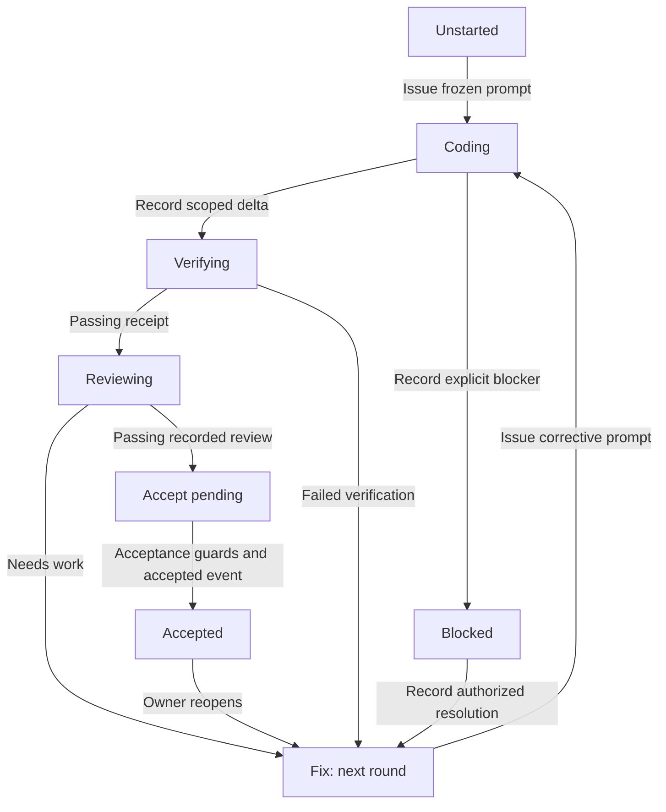

# RelayForge workflow graph

This is a source-backed navigation map of the imported v4 manual /2 workflow,
audited 2026-10-25. It is documentation, not an executable graph or live status.
Run `python -B scripts/ledger.py status` for the current step and
`python -B scripts/ledger.py check` for evidence consistency.
The roadmap owns scope; the ledger owns history. Do not maintain parallel state.

## Existing control flow

The graph already exists in [ledger.fold](../scripts/ledger.py) and the
[protocol guards](../scripts/_protocol.py). Each worker may run its own local
reason/act/observe loop inside one bounded workflow step.

This diagram summarizes normal slice flow. It does not enumerate every legal
event. [The ledger contract](ledger.md) and script guards define exact legality;
[operating instructions](operating.md) define the supported commands.

| Boundary | Required evidence/control | Owner and source |
|---|---|---|
| Issue → coding | Valid admitted slice; frozen envelope and prompt; attributable baseline | Architect; prompt.py main |
| Coding → verifying | Git delta inside allowed prefixes; changed manifest and optional notes | Architect records; ledger.py coded |
| Verifying → reviewing/fix | Receipt bound to a stable candidate snapshot; actual command outcome | verify.py main; ledger.py fold |
| Reviewing → acceptance/fix/block | Recorded report and verdict; original acceptance envelope; finding dispositions | Read-only reviewer, architect records; ledger.py and _protocol.py |
| Acceptance → accepted | Candidate/evidence checks; pending commit uses exact intent recovery | Architect; ledger.py, _commit.py |
| Blocked → correction | Explicit resolution evidence and authority; frozen scope retained | Authorized resolver; _protocol.py |
| Interrupted work → resume | Existing artifacts, ledger and external invocation reconciled | Architect; operating.md Recovery |

Global guards matter before choosing a local edge: `_protocol.ensure_writable`
blocks new writes while a commit intent is pending or an attempt is unfinished.
The slice's `accept_pending` state means a passing review awaits acceptance.
An optional pending Git commit intent is a separate global recovery condition;
it is not that slice state.
An apparent next slice does not bypass these guards. Resolve exact pending work
using [recovery instructions](operating.md#recovery).

## Budgets and stopping: implemented versus active

The template includes optional autonomy profiles in `_autonomy.py`, with
run scope and job/retry/time/corrective allowances. This project's roadmap has
no autonomy block as of the audit. Do not claim those limits govern the current
manual session, or that a limit written in a goal is enforced by software.

The current manual procedure has verification, review, blocker and acceptance
boundaries. Before admitting unattended execution, specify actual enforced
attempt/time/cost limits and qualify the compatible runner. A changed hypothesis
is required before retrying. Exhausted evidence or missing authority is a reason
to report a blocker; it is not evidence of successful completion.

## Bounded adaptations

The immediate adaptation is this navigation map and the
[bootstrap goal](../prompts/GOAL_RELAYFORGE_BOOTSTRAP.md), reachable from startup.
They reuse the existing commands, ledger, frozen envelopes and review gates.

Only admit further machinery against a concrete need:
- Machine consumers needing next-action inspection: add a read-only projection
  of folded state, guards, required evidence and next actor/action. Derive it
  from the current implementation and test parity; do not invent a writable graph.
- Unattended execution: qualify the runner and enable an explicit bounded profile
  through the project's admission process.
- Parallel dependent slices: define dependency and join semantics only when an
  admitted task requires them. Current sequential foundation work does not.
- Routing: RelayForge may later recommend model/effort within eligible candidates.
  JEV cannot alter graph authority, permissions, budgets or acceptance requirements.

A diagram cannot prove recovery or acceptance correctness. Future executable
changes need relevant transition and interruption checks against real artifacts.
This audit inspected source and current status; it did not execute a slice or
prove unattended operation.

## Research retained

[Loop & Graph Engineering](https://cc.bruniaux.com/guide/loop-graph-engineering/)
provides useful prompts for inspecting state, edges, retries, checkpoints and
completion authority. [Harness, Loop, Graph](https://medium.com/@malenezi/harness-loop-graph-the-agent-stack-nobody-draws-correctly-aa919163b57e)
motivates separating runtime, feedback and control-flow responsibilities.
These practitioner sources are design inputs; their existence proves no
performance improvement. The retained action is to expose and evaluate v4's
existing controls before adding a subsystem.
